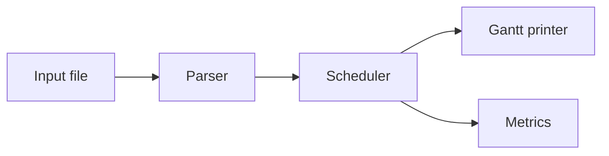

# 06 · Documentation Guidelines

Good documentation proves your understanding and lets other users run your project without you.

## 1. Required Documents

| File | Purpose |
|------|---------|
| `README.md` | First impression, build/run, demo |
| `docs/PROPOSAL.md` | Approved idea and plan |
| `docs/DESIGN.md` | Architecture, modules, data structures, diagrams | 
| `docs/OS_CONCEPTS.md` | The theory your project uses, in your own words |
| `docs/USER_GUIDE.md` | How to use every command/option, with examples |
| `docs/CODE_EXPLANATIONS.md` | File-by-file/function-by-function explanation |
| `docs/AI_USAGE_LOG.md` | Honest record of AI assistance |
| `docs/TEST_REPORT.md` | Tests, results, bugs fixed |
| `docs/progress/week-N.md` | Weekly reports |

## 2. README Must Answer in 60 Seconds
1. What is this project? (one sentence + screenshot/GIF)
2. Which OS concept does it demonstrate?
3. How do I **build** it? (copy-paste commands)
4. How do I **run** it? (sample command + sample output)
5. What features exist (and what does **not**)?
6. Who built it? (names, IDs, GitHub usernames)

## 3. Writing Good Design Docs
- Include **one architecture diagram** (boxes and arrows are enough).
- Describe each **module's responsibility** in one sentence.
- List **key data structures** with field meanings.
- Explain **design decisions** and rejected alternatives ("We used a circular queue instead of a linked list because...").
- State **limitations** honestly.

### Diagrams With Mermaid (renders on GitHub)
````markdown

````

## 4. OS_CONCEPTS.md Outline
For each concept: **Definition → Why the OS needs it → Algorithm/steps → Example → How our project models it → Real OS example (Linux).**
Write it **yourself** (AI may help you understand, but your words must show your understanding).

## 5. CODE_EXPLANATIONS.md — The Most Valuable File
For each source file:
- **Purpose** (1–2 sentences)
- **Key functions** (what each does, inputs/outputs)
- **Tricky lines** explained in plain words
- **OS concept** shown
- **Who wrote / who reviewed**
- **Whether AI helped, and what you changed**

## 6. Writing Style
- Short sentences, simple English, correct spelling
- Use tables and bullet points
- Show example commands **and** their output
- Keep docs updated when code changes
- Proofread before the final tag
